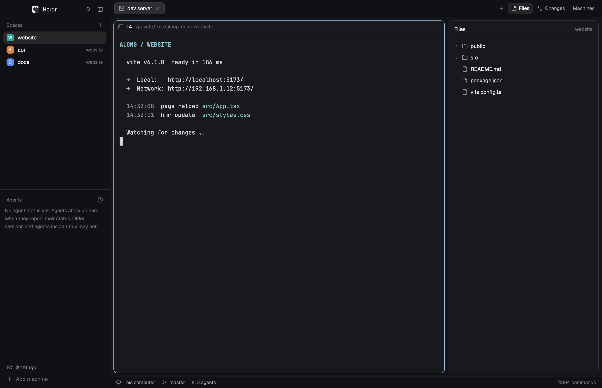

# Along

Right-clicking a file row in the Files or Changes panel opens a small menu
with copy actions for the absolute path, relative path, and name.

## Built from

This package clones the shipped `files` and `changes` panels into
`along-files` and `along-changes`, adds the `along-menu` and `along-machines`
overlays, and uses a
personal `along` layout cloned from `main`. The layout points its
Files and Changes stack at the personal panel copies.

## Done when

- The four mods pass `herdr-app check`.
- The `along` layout opens and shows Files and Changes.
- Right-clicking a row opens the copy menu and each item writes to the
  clipboard.
- The Machines button keeps disabled machine profiles and can enable them
  again with `hc machine add`.

## Watch out

The package reads the focused folder and repository through the same local
commands as the shipped panels. It does not use the network. Keep the personal
copies when Herdr updates; shipped mods can change independently.

Disabling a machine removes it from the local herdr-core registry, so its
spaces disappear from the current Herdr window until it is enabled again.
The remote terminals and the saved Along profile in shared state remain available.
